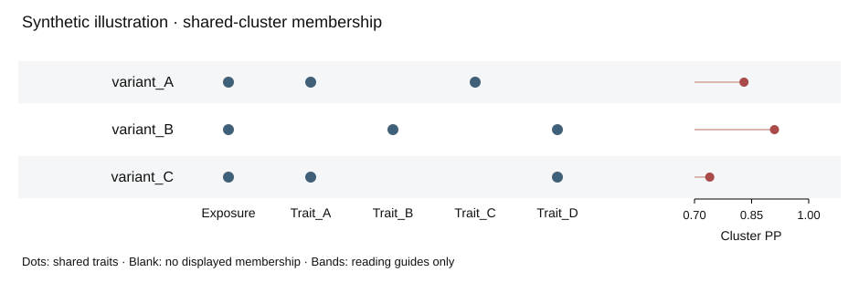

# Read a shared cluster as one relationship

**Synthetic illustration — these are invented identifiers and probabilities for testing the drawing contract, not study findings.**



Example prompt: “保留已认可的点阵和 PP 棒棒糖，让每个位点对应的共享性状能沿同一行读清楚，不重跑统计。”

```bash
python examples/cluster-membership/render_demo.py
python scripts/check_cluster_membership.py \
  --clusters examples/cluster-membership/clusters.tsv \
  --memberships examples/cluster-membership/memberships.tsv \
  --rendered-memberships examples/cluster-membership/plotted-members.tsv \
  --source-traits 'Exposure|Trait_A|Trait_B|Trait_C|Trait_D' \
  --pp-threshold 0.70 --out local-reports/cluster-audit.json
```

Open `preview.html` for mouse, keyboard focus and click row highlighting; Escape clears selection. The static SVG remains readable independently. Only the actual member cells get dots; faint row bands have no statistical meaning. Blank does not mean a negative GWAS association. Cluster PP is separate from the candidate-SNP posterior fraction.

The renderer uses only the Python standard library to make this tiny portable demo. It is **not** a HyPrColoc runner or a replacement for an author's existing R/ggplot2 code. The audit checks a data-to-mark contract; opening and inspecting the final exported artwork is a separate requirement.
