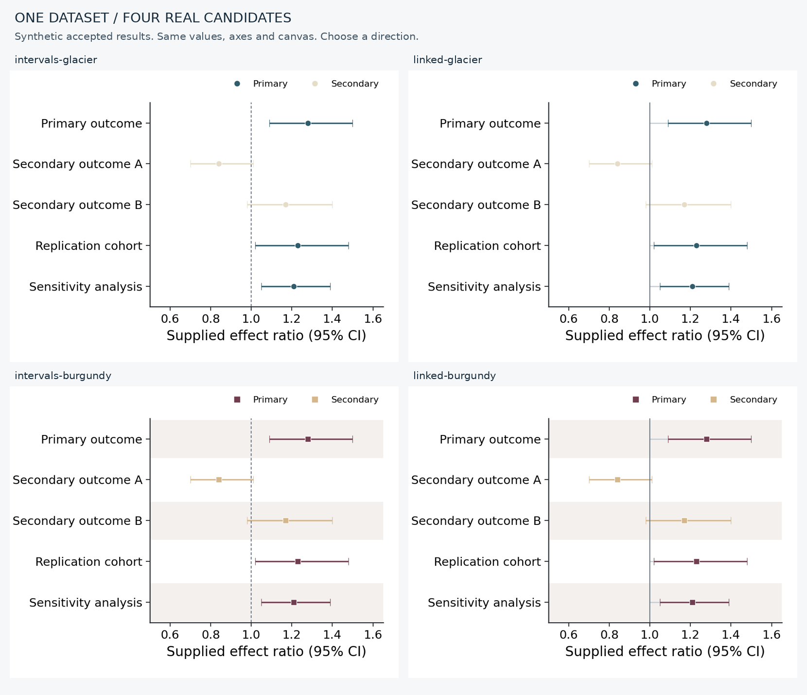

# Showcase: 四个候选图与一个可恢复选择

上图是一次本机已审阅安装的活体验证：同一份五行模拟已接受结果，调用现有 `make-sci-data-figures` forest 入口与 `sci-color-palettes` 取色，生成两个表达形式（区间、参考线连接）和两种样式（冷色圆点、暖色方点与行引导）。画布、数值、区间、行序、参考线和坐标范围固定。它证明比较器、证据和选择链路真实可用，不代表所有绘图后端都能接受同一接口。

- [真实离线 gallery](/home/daxuan/.codex/visualizations/2026/11/01/01a19467-e890-76e3-8a51-2dc6fb8ad65c/daxuan-figure-router-next/local-demo/run/gallery.html)
- [结果清单](/home/daxuan/.codex/visualizations/2026/11/01/01a19467-e890-76e3-8a51-2dc6fb8ad65c/daxuan-figure-router-next/local-demo/run/gallery.json)
- [运行脚本](../examples/comparison/render_demo.py)
- [模拟输入](../examples/comparison/accepted-results.csv)

这份截图使用本机 reviewed local source，public pinned bootstrap 在当前网络环境中尚未成功；脚本会强制检查 pinned receipt，只有 `skill_bundle.py` 安装成功后才可按公开源复现。选择 `intervals-glacier` 已实际写入 append-only history，其他三个候选仍保留，选择状态是待精修。
